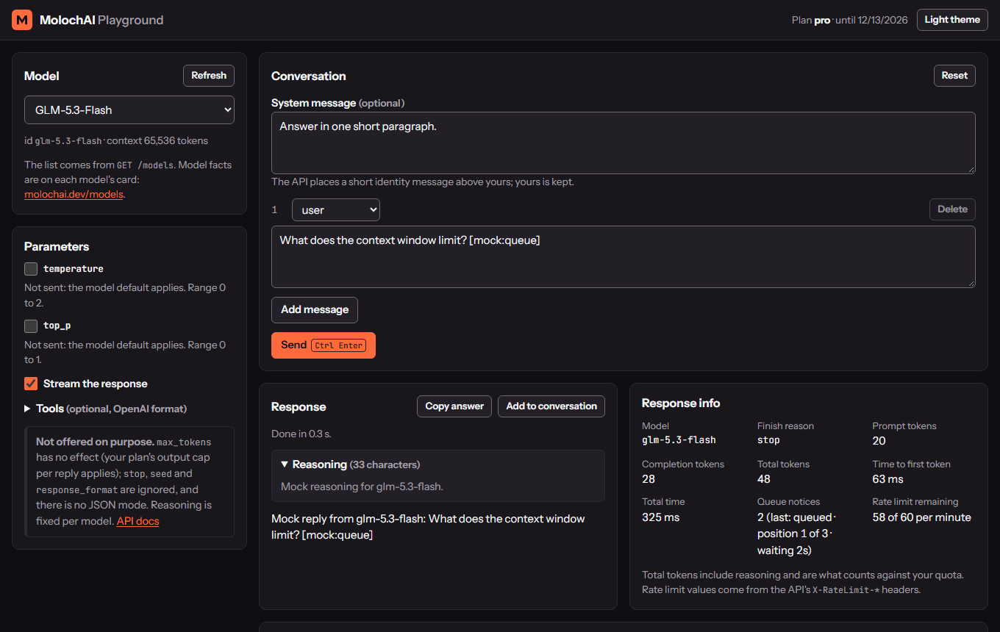
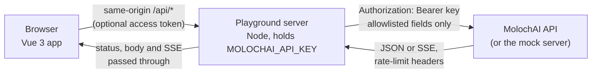

# MolochAI Playground

[](https://github.com/Moloch-AI/ai-model-playground/actions/workflows/ci.yml)
[](LICENSE)

A web playground for the MolochAI API (and other OpenAI-compatible endpoints) that you run
locally or self-host, with a small Node server that keeps the API key out of the browser.



<sub>Screenshot taken against the [mock server](#run-against-the-mock-server): the replies are
canned text, not model output.</sub>

## Overview

The playground is for developers trying out the
[MolochAI API](https://molochai.dev/docs?utm_source=github&utm_medium=oss&utm_campaign=ai-model-playground):
pick a model, write a system message and a conversation, stream the reply, and see what the API
actually sent back (reasoning, finish reason, token usage, queue position, rate-limit headers and
errors). When a request does what you want, copy it as curl or Python.

MolochAI serves less-restricted open-weight models: refusal behavior is reduced, the models still
sometimes decline, and they are not more accurate than their base models. The
[Acceptable Use Policy](https://molochai.dev/acceptable-use?utm_source=github&utm_medium=oss&utm_campaign=ai-model-playground)
applies, and anything you put in front of end users needs its own rules and moderation.

API keys are not scoped (a key can read account details and create invoices), so they must never
reach a browser. The playground therefore has two parts:



- **The web app** (`src/`, Vue 3 + Vite + TypeScript) talks only to the playground server.
- **The playground server** (`server/`, Node built-ins, no runtime dependencies) serves the built
  app, adds the key, and forwards three routes: the model list, chat completions and the account
  limits. It streams server-sent events through unchanged, including the comment lines that carry
  queue progress.

Other repositories in the ecosystem: the HTTP contract and the mock server live in
[uncensored-ai-api](https://github.com/Moloch-AI/uncensored-ai-api); SDKs in
[uncensored-ai-python](https://github.com/Moloch-AI/uncensored-ai-python) and
[uncensored-ai-node](https://github.com/Moloch-AI/uncensored-ai-node); runnable examples in
[uncensored-llm-examples](https://github.com/Moloch-AI/uncensored-llm-examples).

## Features

- **Model picker** filled from `GET /models`, with display names. Models that no server is serving
  right now are marked unavailable; choosing one explains that requests return
  `503 model_unavailable` and that the API never switches to another model for you.
- **Prompt editor**: optional system message and a multi-turn conversation (add, edit, delete,
  reset; roles `user`, `assistant`, `tool`). In the editor, <kbd>Ctrl</kbd>/<kbd>Cmd</kbd>+<kbd>Enter</kbd>
  sends and <kbd>Esc</kbd> stops a running request.
- **Streaming output** rendered as it arrives, with reasoning (`reasoning_content`) in a
  collapsible panel apart from the answer, and a Stop button that cancels the request all the way
  to the API.
- **Non-streaming mode**. If a plain reply carries its reasoning inline in a `<think>` block (the
  gateway strips those only while streaming), it is split into the reasoning panel.
- **Parameters**: `temperature` (0 to 2) and `top_p` (0 to 1), unset by default so the model's
  defaults apply. `max_tokens`, `stop`, `seed` and `response_format` are deliberately not offered:
  the API ignores them or overrides them with the plan's output cap, and a note says so.
- **Tools** (optional): a JSON editor for `tools` in OpenAI format and `tool_choice`. Tool calls
  are shown, and "Add to conversation" adds the assistant turn plus a `tool` message with the
  matching `tool_call_id` to fill in.
- **Response info**: model, finish reason, prompt/completion/total tokens, time to first token,
  total time, queue notices seen and `X-RateLimit-Remaining`.
- **Error messages** mapped from the HTTP status and error `type`: 401, 402, 403, 413 (with
  `context_cap` and whether the plan or the server sets the limit), 422 field errors, the three
  kinds of 429 (with `resets_at` or `Retry-After`), 502/503/504/524, and errors that arrive inside
  a stream (such as `preempted`), each with what to do next.
- **Cap notice**: when a reply stops at the plan's output cap, the text
  `[Response is too large for your current plan. Try a smaller request.]` is shown as a notice, not
  as part of the answer, and is left out when the reply is added to the conversation.
- **Reasoning across turns**: replies added to the conversation keep their reasoning and send it
  back as `reasoning_content`.
- **Copy** the answer, or the same request as curl or Python (OpenAI SDK). Both read the key from
  `$MOLOCHAI_API_KEY`.
- **Light and dark themes** following `prefers-color-scheme`, with a toggle that is remembered.
  Keyboard usable, visible focus, WCAG AA text contrast (checked by a test), works down to 360 px
  wide. Fonts are self-hosted; the page makes no requests to other hosts.

With another OpenAI-compatible endpoint the basics (model list, chat, streaming, errors by status)
should work; the MolochAI extensions (availability, account limits, queue notices, cap notice)
appear only when the endpoint sends them. Only the MolochAI mock server is tested here.

## Requirements

- Node.js 22.12 or newer to install, build and test (Vitest 5 needs it).
- The built server runs on Node.js 20.19 or newer and has no runtime dependencies.
- Or only Docker: the image builds and runs without Node on the host ([Run with Docker](#run-with-docker)).
- A MolochAI API key from the [dashboard](https://dash.molochai.dev/account?utm_source=github&utm_medium=oss&utm_campaign=ai-model-playground),
  or the mock server for offline use.

The playground is an application, not a package: nothing is published to npm.

## Installation

```bash
git clone https://github.com/Moloch-AI/ai-model-playground.git
cd ai-model-playground
npm ci
cp .env.example .env
```

Put your key in `.env` (`MOLOCHAI_API_KEY=...`). The server reads `.env` from the project root at
start; variables set in the environment win over the file.

## Quickstart

```bash
npm run build
npm start
```

Open http://127.0.0.1:8787. For development with hot reload, run `npm run dev` instead: the same
server runs Vite in middleware mode, so the app and `/api` share one port and there is no separate
proxy to configure.

## Run with Docker

No image is published to a registry; build it from this repository (Node is not needed on the
host):

```bash
git clone https://github.com/Moloch-AI/ai-model-playground.git
cd ai-model-playground
docker build -t ai-model-playground .
export MOLOCHAI_API_KEY=your-api-key
docker run --rm -p 127.0.0.1:8787:8787 -e MOLOCHAI_API_KEY -e PLAYGROUND_ALLOW_NO_TOKEN=true ai-model-playground
```

Open http://127.0.0.1:8787. `--env-file .env` works instead of `-e` (values without quotes, and
leave `HOST` out).

Inside the container the server listens on 0.0.0.0, so it refuses to start unless you either set
an access token or say, with `PLAYGROUND_ALLOW_NO_TOKEN=true`, that nobody else can reach the
port. That opt-out is only safe with `-p 127.0.0.1:8787:8787`, which publishes the port on your
machine's loopback interface. **With `-p 8787:8787` anyone who can reach your machine can spend
your quota**, and the key is not scoped. For a team, use `PLAYGROUND_ACCESS_TOKEN` and HTTPS.

The image is two-stage: `npm ci` and `vite build` on a pinned `node:22` Alpine image, then a
runtime with only the server, the built app and Node (no `node_modules`), running as a non-root
user with a health check on `/healthz`. [docs/deployment.md](docs/deployment.md) covers env files,
the access token, running behind a reverse proxy with `PLAYGROUND_TRUST_PROXY`, what the rate limit
does and does not do, and why a public demo with a real key is not a good idea today.

## Usage examples

### Run against the mock server

The mock server from [uncensored-ai-api](https://github.com/Moloch-AI/uncensored-ai-api) simulates
the documented API behavior with canned replies, so you can try everything offline and without a
key. With both repositories next to each other:

```bash
git clone https://github.com/Moloch-AI/uncensored-ai-api.git ../uncensored-ai-api
node ../uncensored-ai-api/mock-server/server.mjs --port 4010
```

In a second terminal:

```bash
MOLOCHAI_BASE_URL=http://127.0.0.1:4010/api/v1 MOLOCHAI_API_KEY=mock-key npm start
```

(or put those two values in `.env`). The mock reacts to markers in the last user message, which
makes it easy to see each behavior in the UI:

| Type this in a message | What you see |
|---|---|
| `[mock:queue]` | queue comments before the reply, counted under Response info |
| `[mock:cap]` | `finish_reason: length` and the cap notice |
| `[mock:inline-think]` (streaming off) | inline `<think>` reasoning split into the reasoning panel |
| `[mock:context]` | 413 with the context limit and that the plan sets it |
| `[mock:quota]`, `[mock:session-quota]` | 429 with the reset time |
| `[mock:rate-limit]` | 429 with `Retry-After` |
| `[mock:busy]`, `[mock:unavailable]` | 503 `server_busy`, `model_unavailable` |
| `[mock:preempted]`, `[mock:timeout]` (streaming on) | an error event inside the stream after partial text |
| `[mock:cloudflare-524]` | a non-JSON 524 edge timeout |
| `[mock:slow=10000]` | a slow reply to try the Stop button on |

Start the mock with `--unavailable gemma4-26b-a4b-qat` to see an unavailable model in the list.

### Serve it to other machines

The server refuses to listen on a non-loopback address unless an access token is set:

```bash
HOST=0.0.0.0 PLAYGROUND_ACCESS_TOKEN="$(node -e "console.log(require('node:crypto').randomBytes(24).toString('base64url'))")" npm start
```

The browser asks for the token once per tab and keeps it in session storage. Put HTTPS in front
of the server (a reverse proxy that terminates TLS), make the proxy pass the original `Host`
header, and set `PLAYGROUND_TRUST_PROXY=true` so rate limiting sees client addresses. Read
[Security considerations](#security-considerations) and [docs/deployment.md](docs/deployment.md)
first.

### Run the checks

```bash
npm run lint        # Biome (lint and format check)
npm run typecheck   # vue-tsc for the app, the tests and the server
npm test            # Vitest: unit, server and component tests
npm run build
npm run test:e2e    # starts the mock and the built server, drives them over HTTP
npx playwright install --only-shell chromium
npm run test:browser
```

`test:e2e` and `test:browser` expect the mock at `../uncensored-ai-api/mock-server/server.mjs`;
set `MOLOCHAI_MOCK_SERVER` to its path otherwise. To run the smoke test against a playground that
is already running (CI does this for the Docker image), set `E2E_PLAYGROUND_URL`, and
`E2E_ACCESS_TOKEN` if it has a token.

## Configuration

All settings are environment variables (or lines in `.env`).

| Variable | Default | Meaning |
|---|---|---|
| `MOLOCHAI_API_KEY` | (required) | API key, sent upstream as `Authorization: Bearer`. Never sent to the browser. `mock-key` for the mock server. |
| `MOLOCHAI_BASE_URL` | `https://api.molochai.dev/api/v1` | API base URL. The account route is derived from it (`.../v1` becomes `.../auth/me`). |
| `HOST` | `127.0.0.1` (`0.0.0.0` in the Docker image) | Address to listen on. A non-loopback address requires `PLAYGROUND_ACCESS_TOKEN` (or, in a container, `PLAYGROUND_ALLOW_NO_TOKEN`). |
| `PORT` | `8787` | Port to listen on. |
| `PLAYGROUND_ACCESS_TOKEN` | (unset) | Shared secret browsers must send to use `/api`. At least 16 characters. When unset, the server only answers requests addressed to `localhost`, `127.0.0.1` or `[::1]`. |
| `PLAYGROUND_ALLOW_NO_TOKEN` | `false` | `true` lets the server listen on a non-loopback `HOST` without a token. Only for a container whose port is published on the host's 127.0.0.1 (`docker run -p 127.0.0.1:8787:8787`); see [docs/deployment.md](docs/deployment.md). No effect when a token is set. |
| `PLAYGROUND_RATE_LIMIT` | `60` | `/api` requests per minute per client address; `0` turns it off. |
| `PLAYGROUND_MAX_BODY_BYTES` | `4194304` | Largest accepted chat request body (4 MiB). |
| `PLAYGROUND_TRUST_PROXY` | `false` | Take the client address from the last `X-Forwarded-For` entry (only behind a proxy you control). |

Command-line flags: `node server/index.js --dev` (Vite with hot reload) and `--quiet` (no request
log).

## API reference

The playground server's own HTTP interface, used by the web app. Responses from the API keep
their status code, body and the `X-RateLimit-*` and `Retry-After` headers.

| Route | Forwards to | Notes |
|---|---|---|
| `GET /api/models` | `GET {base}/models` | Unchanged. |
| `POST /api/chat` | `POST {base}/chat/completions` | JSON body; only `model`, `messages`, `stream`, `temperature`, `top_p`, `tools` and `tool_choice` are forwarded, everything else is dropped. SSE is streamed byte for byte. Closing the connection aborts the upstream request. |
| `GET /api/account` | `GET {base minus /v1}/auth/me` | Filtered to `plan`, `plan_expires_at`, `tier`, `context_limit`, `default_model` and `models`; email, account id and credit are not passed on. |
| `GET /healthz` | (none) | `{"ok":true}`, no token needed. |
| everything else | (none) | The built app from `dist/` (GET and HEAD only). |

Errors raised by the playground server itself use the API's error shape with a `playground_`
prefix, so the app can tell them apart from API errors:
`{"error":{"type":"playground_auth_required","message":"..."}}`. Types:
`playground_auth_required` (401), `playground_forbidden_host` and `playground_forbidden_origin`
(403), `playground_rate_limited` (429 with `Retry-After`), `playground_body_too_large` (413),
`playground_unsupported_media_type` (415), `playground_invalid_json` and
`playground_invalid_body` (400), `playground_not_found` (404), `playground_method_not_allowed`
(405), and `playground_upstream_unreachable`, `playground_upstream_redirect` and
`playground_upstream_too_large` (502).

## Troubleshooting

| Symptom | Cause and fix |
|---|---|
| `MOLOCHAI_API_KEY is not set` at start | Copy `.env.example` to `.env` and set the key, or export it. |
| `Refusing to listen on 0.0.0.0 without PLAYGROUND_ACCESS_TOKEN` | Intended. Set a token (see [Serve it to other machines](#serve-it-to-other-machines)) or keep `HOST=127.0.0.1`. In Docker, either set a token or publish with `-p 127.0.0.1:8787:8787` and add `-e PLAYGROUND_ALLOW_NO_TOKEN=true` ([Run with Docker](#run-with-docker)). |
| Docker: the container runs but http://127.0.0.1:8787 does not answer | The env file sets `HOST=127.0.0.1`, which is the container's own loopback: remove that line. Also check that the port is published (`-p 127.0.0.1:8787:8787`). |
| Docker: 502 "could not reach the API" with `MOLOCHAI_BASE_URL=http://127.0.0.1:...` | Inside the container 127.0.0.1 is the container itself. Run the mock in a container on the same Docker network ([docs/deployment.md](docs/deployment.md#try-it-against-the-mock-server)). |
| Docker: 401 from the API with a key from `--env-file` | Docker keeps quotes as part of the value. Write `MOLOCHAI_API_KEY=...` without quotes. |
| `The UI is not built yet` | Run `npm run build` before `npm start`, or use `npm run dev`. |
| "Blocked by the playground server" (403) | Without a token the server only answers on `localhost`/`127.0.0.1`/`[::1]`. Open it through one of those names, or set a token. Behind a reverse proxy, also pass the original `Host` header so it matches the page's origin. |
| "The API did not accept the key" (401) | `MOLOCHAI_API_KEY` is wrong or revoked. Fix it and restart the server. |
| "No active plan and no credit" (402) | The account needs a plan or credit; see [pricing](https://molochai.dev/pricing?utm_source=github&utm_medium=oss&utm_campaign=ai-model-playground). |
| "No server is serving ... right now" (503) | That model has no server at the moment. Try again later or pick another model. |
| "Edge timeout (524)" | A non-streamed request ran past about 100 seconds. Turn streaming on. |
| "The playground server could not reach the API" (502) | Check `MOLOCHAI_BASE_URL` and the server's network. |
| The reply appears all at once behind a reverse proxy | The proxy buffers responses. The server sends `X-Accel-Buffering: no` (nginx honors it); for other proxies, turn response buffering off for `/api/chat`. |
| Copy buttons fail on a plain-HTTP LAN address | Browsers allow the clipboard API only on HTTPS or localhost; the fallback may be blocked. Serve over HTTPS. |

## Security considerations

The playground server is a relay that spends your API quota. Treat exposing it like exposing the
key itself.

- **The key stays on the server.** The browser never receives it; generated curl and Python code
  reads it from `$MOLOCHAI_API_KEY`. Keys are not scoped, so this matters: anyone holding the key
  can read account details and create invoices.
- **Open-relay risk.** Anyone who can reach `/api/chat` can send prompts on your account, use up
  your quota and read the replies. The defaults guard against that:
  - it binds to `127.0.0.1` and refuses to start on any other address without
    `PLAYGROUND_ACCESS_TOKEN`. The Docker image binds `0.0.0.0` and keeps that rule; only an
    explicit `PLAYGROUND_ALLOW_NO_TOKEN=true` lifts it, for a port published on the host's
    127.0.0.1 (the server cannot check that, so it is on you);
  - without a token it only answers requests addressed to a loopback name, which blocks DNS
    rebinding and a reverse proxy that exposes it by accident;
  - `/api` rejects cross-site requests (`Origin` and `Sec-Fetch-Site` checks), so other websites
    open in your browser cannot use it;
  - only three upstream routes exist, and only allowlisted chat fields are forwarded;
  - request bodies are capped and `/api` is rate-limited per client address (in memory, per
    process). The rate limit slows abuse; it does not cap your spending.
- **The access token is one shared secret**, not user accounts. Anyone with it can use your key
  through the playground. Use a long random value, serve the playground only over HTTPS (over plain
  HTTP the token is readable on the network), and change it by restarting with a new value. The
  browser keeps it in session storage, which is cleared when the tab closes.
- **Response hardening.** A strict Content-Security-Policy (`default-src 'none'`, scripts, styles,
  fonts and requests only from the same origin, no inline code, no framing), `nosniff`,
  `Referrer-Policy: no-referrer`, and no requests to third parties. Model output is rendered as
  plain text, never as HTML. Non-JSON upstream bodies (such as an HTML error page) are relayed as
  `text/plain`.
- **Logging and storage.** The server logs one line per request (method, path, status, duration).
  It never logs prompts, replies, tokens or keys, and it stores nothing. The browser stores only
  the theme choice (local storage) and the access token (session storage); conversations are not
  saved.
- **Redirects are not followed**, so the key is never sent to a host other than the one in
  `MOLOCHAI_BASE_URL`.
- **Your responsibility.** If you let other people use the playground, the Acceptable Use Policy
  still applies to everything sent with your key, and you need your own rules and moderation for
  those users.
- **No public demo with a real key.** A publicly reachable instance is a public tap on your
  account; see [docs/deployment.md](docs/deployment.md#public-demo-eg-hugging-face-spaces) for why
  and what would have to change first.

Report vulnerabilities as described in [SECURITY.md](SECURITY.md).

## Contributing

See [CONTRIBUTING.md](CONTRIBUTING.md) for the development setup, the checks CI runs and the
project layout.

## License

[MIT](LICENSE). Copyright (c) 2026 MolochAI. The bundled fonts (Instrument Sans, JetBrains Mono)
are under the SIL Open Font License 1.1 and come from the `@fontsource-variable` packages.
